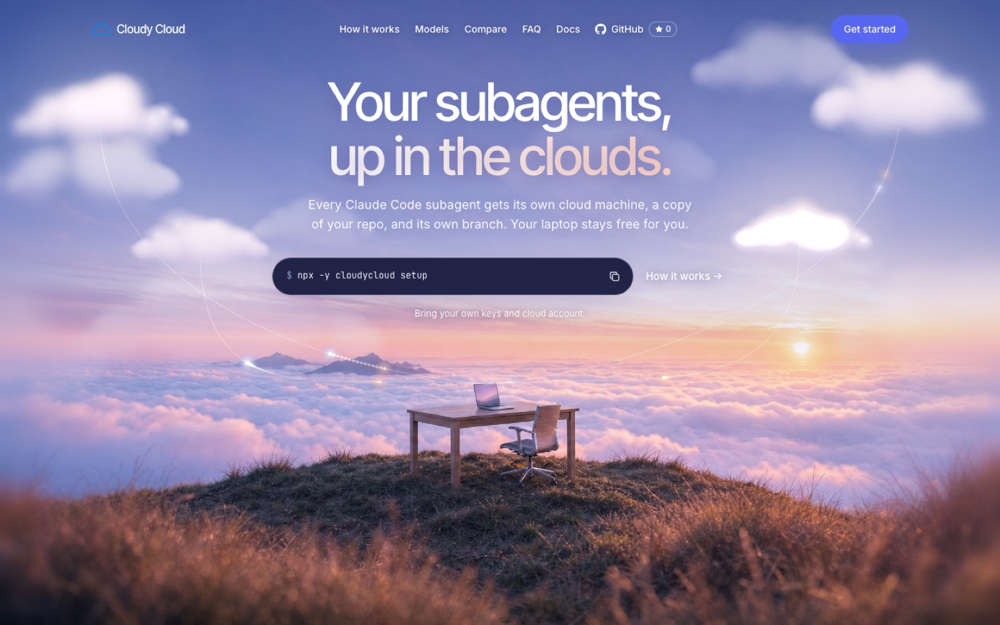
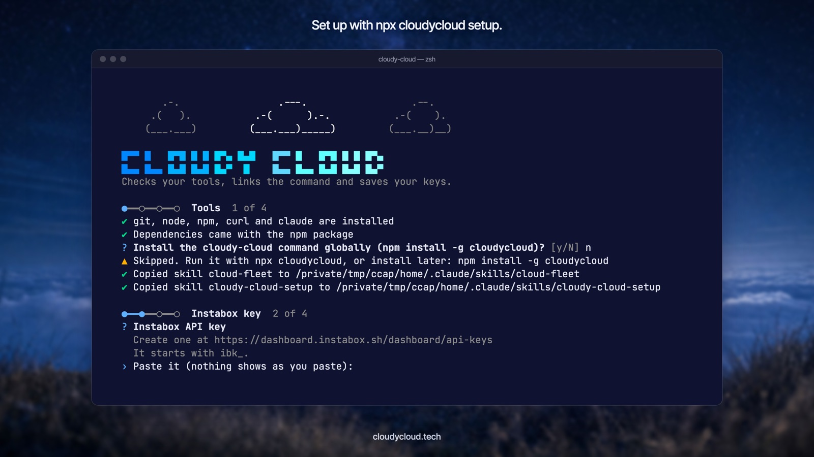
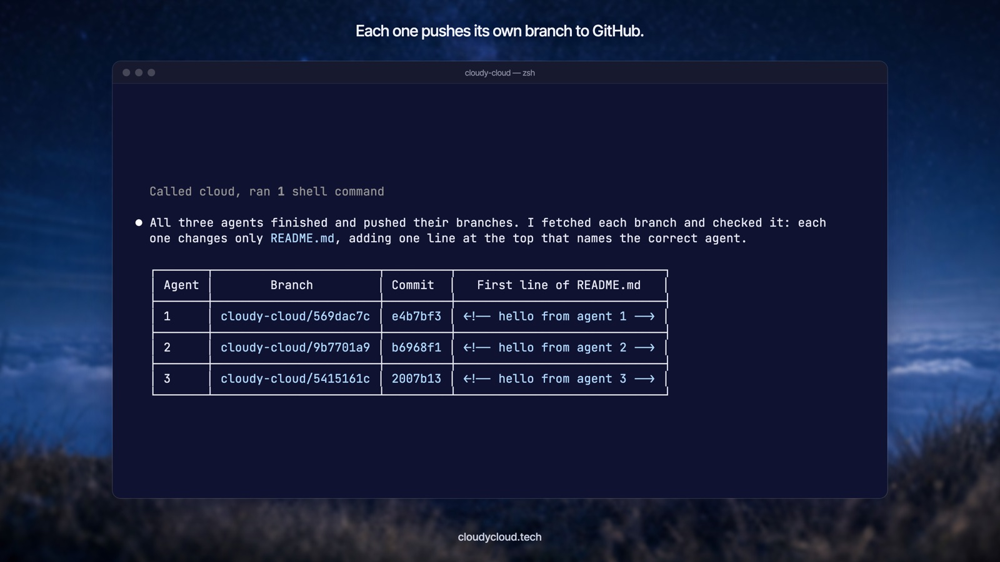
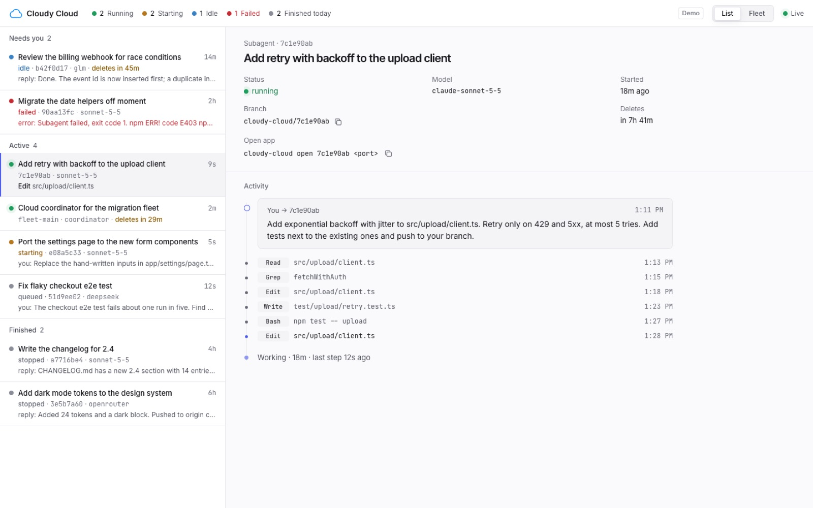
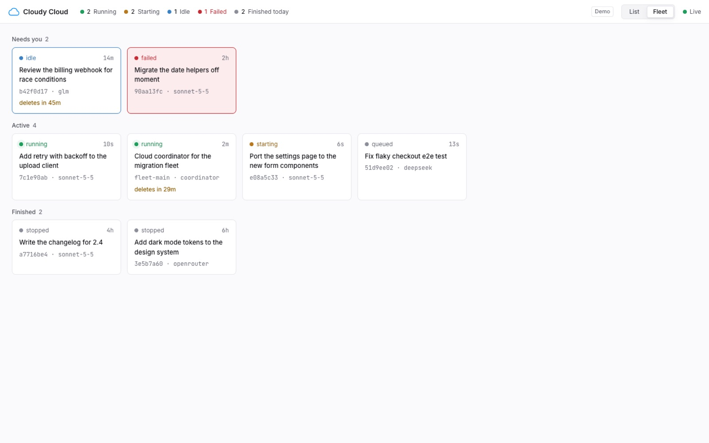

# Cloudy Cloud

Cloudy Cloud is open-source software (MIT license, install with `npx cloudycloud setup`) that gives every subagent of your coding agent its own cloud machine, a copy of your repo, and its own branch.

[](https://www.npmjs.com/package/cloudycloud)
[](LICENSE)
[](https://cloudycloud.tech/docs/)

[Website](https://cloudycloud.tech) · [Docs](https://cloudycloud.tech/docs/) · [npm](https://www.npmjs.com/package/cloudycloud)



You run `cloudy-cloud` instead of `claude`. It starts an ordinary Claude Code session. When that session uses a subagent, the subagent runs as its own Claude Code on its own cloud machine by default. Your main session can also be Codex, opencode, pi or free-pi, and a worker can run Claude Code, pi, oh-my-pi, Codex or opencode (see [Supported agents](#supported-agents)). It commits and pushes its work to a branch on your GitHub repo, and it stays open for follow-up messages until it is stopped. Plain `claude` is not affected.

## Why

Subagents that run on your laptop share its CPU, memory and network. Ten of them building, testing and installing packages at once can slow your own work down. With Cloudy Cloud each subagent runs on a separate cloud machine, so your laptop stays free for you, and a subagent that runs a long build or test does not compete with the others. Each subagent also gets its own branch, so parallel work does not collide in one working folder.

## Supported agents

| Role | Agents |
| --- | --- |
| Main session (the agent you talk to) | Claude Code (`cloudy-cloud`), Codex (`cloudy-cloud codex`), opencode (`cloudy-cloud opencode`), pi (`cloudy-cloud pi`), free-pi (`cloudy-cloud free-pi`) |
| Worker (the agent on each cloud machine, chosen with the `profile` argument of `cloud_agent`) | Claude Code (default), pi, oh-my-pi (`omp`), Codex, opencode. free-pi cannot be a worker |

The main session and the workers are chosen independently. Any main session can start any kind of worker. Coordinators always run Claude Code. What has been verified for each agent (verified live, partly verified, or not verified on a real machine) is in one table: [docs/STATUS.md](docs/STATUS.md#supported-agents-and-what-is-proven).

## Quick start

Requirements:

- **Accounts:** an [Instabox](https://instabox.sh) account (the cloud provider supported today; its free plan is too small for more than a few subagents at once), a credential for each kind of worker you use (for Claude Code workers, a Claude subscription: setup makes a long-lived token with `claude setup-token`; or an Anthropic API key, which you add as `ANTHROPIC_API_KEY=...` to `~/.config/cloudy-cloud/env` yourself), and a GitHub repo you can push to.
- **On your computer:** macOS or Linux (tested on macOS), `git`, Node.js 20 or later, `npm`, `curl`, and the agent you will use as your main session: [Claude Code](https://code.claude.com) signed in (the default), or Codex (`npm install -g @openai/codex`), opencode (`npm install -g opencode-ai`), pi or free-pi. The other agents do not need a Claude token. pi and free-pi run through `npx` if they are not installed.

Run setup once, in a terminal:

```sh
npx -y cloudycloud setup
```

(`-y` skips npm's "Ok to proceed?" question. If `npm install -g cloudycloud` fails with `EEXIST`, the old `cloudy-cloud` package left a link in npm's global `bin` folder: remove the file named in the error with `rm <that path>`, then run `npm install -g cloudycloud` again. Setup offers to remove it for you.) Setup checks your tools, offers to install the `cloudy-cloud` command (`npm install -g cloudycloud`), copies the Cloudy Cloud skills into `~/.claude/skills/`, uses the agents it finds on your PATH (it asks only if it finds none), and asks for the keys the first agent run needs, with a note on where to get each one:

| Key | Where to get it |
| --- | --- |
| Instabox API key (`ibk_...`) | [dashboard.instabox.sh](https://dashboard.instabox.sh/dashboard/api-keys). Setup checks it with Instabox before saving. |
| Claude token (`sk-ant-oat01-...`), only if you chose claude or want Claude workers | `claude setup-token`, or press Enter at that step and let setup get it. Your own `claude` login is not changed. |
| OpenAI key (`OPENAI_API_KEY`), only if codex is one of your agents; asked in `setup --more` | [platform.openai.com](https://platform.openai.com/api-keys), or use the ChatGPT login file instead; see [Models and keys](#models-and-keys). |
| GitHub token | A [fine-grained token](https://github.com/settings/personal-access-tokens/new) limited to the repos you will use, with Contents, Pull requests and Workflows set to read and write (Workflows lets a subagent push `.github/workflows`), and Actions and Commit statuses set to read (so it can see CI). It is stored in Instabox as the secret `GH_TOKEN`. |

`cloudy-cloud setup --more` adds the extras: cloud coordinators (it signs you in to Claude once and saves an image; 10 to 20 minutes), Instabox usage alert emails, and keys for other models (Particle.ai, OpenRouter). Plain setup never asks about them. It does not set up the Codex ChatGPT login file; see [Models and keys](#models-and-keys).

The Claude step runs only if claude is one of your agents or you want Claude workers. A Codex, opencode or pi user is not asked for a Claude token, and the `claude` command is not required. Workers use the Claude harness unless `cloud_agent` gets a `profile`, so a host session with no Claude token tells the agent which profile to pass (for example `codex`, which needs `OPENAI_API_KEY` or the ChatGPT login file) and prints the same next step on start. Setup warns at the end if no worker credential is saved at all. The other route is to skip setup: add `INSTABOX_API_KEY=ibk_...` to `~/.config/cloudy-cloud/env`, store the GitHub token with `npx --yes instabox@latest secrets set GH_TOKEN --host github.com --host api.github.com`, then run `cloudy-cloud setup --check-only`. The by-hand route has not been tested end to end.
 The Instabox key is saved in `~/.config/cloudy-cloud/env` (setup creates the folder with mode 700 and writes the file with mode 600) and stays on your computer. The Claude token and the provider keys are stored as Instabox proxy secrets, so worker machines see a placeholder; setup asks before moving keys that are already in the env file. Run `cloudy-cloud setup` (`setup --more` for the extra keys) again from any folder to change a key.



You can also run `npx skills add dennisonbertram/cloudycloud`, then ask Claude to "set up Cloudy Cloud". Claude checks your tools and asks you to run the setup command yourself, because setup asks for secret keys.

**Other main sessions.** Skills: setup copies `cloud-fleet` and `cloudy-cloud-setup` into `~/.claude/skills/`, which only Claude Code reads. Nothing installs them for Codex, opencode, pi or free-pi, and whether those agents can use them has not been checked. In those sessions run `npx -y cloudycloud setup` yourself in a terminal, and the session still gets the cloud tools and their built-in instructions. Signing in: Cloudy Cloud does not sign you in to your main agent or give it a model. Sign in to Codex (`codex login`) or opencode the way you normally do before starting `cloudy-cloud codex` or `cloudy-cloud opencode`. pi and free-pi need a model configured in the agent itself (not checked here, and Cloudy Cloud never passes them a key). free-pi-cli asks for consent the first time it runs, and that needs an interactive terminal, so start it once yourself in a terminal. If `pi` or `free-pi-cli` is not installed, `npx` runs a pinned copy. These keys and logins are separate from the worker credentials under [Models and keys](#models-and-keys).

Protect your main branch before you start. A subagent can push to any branch your GitHub token can reach, so add a branch ruleset that blocks direct pushes to it (GitHub: Settings, Rules, Rulesets).

**Start a session** from inside a git repo that has a `github.com` origin:

```sh
cd <your repo>
cloudy-cloud          # or: npx cloudycloud, if you skipped the global install
```

**Run your first subagent.** Ask in plain language:

```
use a subagent to run hostname, write it to proof.txt, commit and push, and tell me the result
```

Claude starts the subagent and returns at once. The answer ends with `Pushed to origin cloudy-cloud/<id> at <sha>`. For several at once, ask for "10 subagents that ...".

**Get the work back.** Nothing is copied into your local repo automatically. Each subagent pushes to its own branch:

```sh
git fetch origin cloudy-cloud/<id>
git show FETCH_HEAD:proof.txt
```

Then merge, cherry-pick or open a pull request with ordinary git. To fetch every subagent branch at once:

```sh
git fetch origin 'refs/heads/cloudy-cloud/*:refs/remotes/origin/cloudy-cloud/*'
```



To run once without the interactive UI, pass `-p`. Nobody is there to approve permission prompts, so allow the commands you need:

```sh
cloudy-cloud -p "<prompt>" --allowedTools "Bash(git fetch *)" "Bash(git show *)"
```

If a key is missing, `cloudy-cloud` says so and offers to run setup. If the folder is not a git repo, or has no `github.com` origin, it warns you that subagents cannot start or push.

## How it works

1. You ask your session for a subagent. The built-in `Agent` tool is turned off, so the request goes to the `cloud_agent` tool.
2. Cloudy Cloud creates a cloud machine and uploads a snapshot of your repo: files tracked by git, including uncommitted edits to tracked files, but not untracked files.
3. The worker agent (Claude Code by default; pi, oh-my-pi, Codex or opencode with a profile) starts on the machine on a new branch, `cloudy-cloud/<id>`, and does the task.
4. The subagent commits and pushes to your GitHub repo. The call returns an MCP task, so you can watch it in `/tasks` (Claude Code 2.1.304 or later, terminal session). Elsewhere, and always in a Codex, opencode or pi main session, the session calls `cloud_agent_wait`.
5. You fetch the branch. You can send follow-up messages to the open subagent first.

```
your computer                              cloud machine (one per subagent)
+--------------------------+   task      +------------------------------+
| cloudy-cloud session     |-----------> | Claude Code on a copy of     |
|  (your normal login)     |<----------- | your repo, branch            |
|                          |   answer    | cloudy-cloud/<id>            |
+--------------------------+             +--------------+---------------+
            ^                                           | git push
            | git fetch origin cloudy-cloud/<id>        v
            +------------------------------------ GitHub (your repo)
```

**How long a machine lives:**

| What ends it | When |
| --- | --- |
| `cloud_agent_stop` | Immediately. |
| Idle timeout | 60 minutes after the subagent went idle. |
| Session end | When you quit Claude Code, every open machine is deleted. A separate cleanup process does the same after a hard kill. |
| Delete deadline | Instabox deletes the machine at a fixed time in any state. The default is 6 hours (`CLOUDY_CLOUD_WORKER_HOURS`, at most 24). It cannot be extended. |

Only work a subagent has pushed to GitHub survives if its machine is lost. A single turn of Claude on the machine is stopped after 29 minutes (machine start-up and queueing are not counted).

Many subagents at once are paced for Instabox's limits. A subagent waiting for a machine shows the status `queued`. Your plan's machine limit still caps how many run at the same time. More in [How it works](https://cloudycloud.tech/docs/how-it-works.html).

## Providers

Cloudy Cloud selects its sandbox provider with `CLOUDY_CLOUD_PROVIDER`: `instabox` (the default), `self-hosted`, `microsandbox` or `zipbox` (experimental). A provider must keep the GitHub token behind proxy secrets or, on your own machine, have your consent to store it there. It must also enforce a delete deadline and forward ports for `cloudy-cloud open`. See the [sandbox provider research](docs/research/sandbox-providers.md) for other options.

## Run on your own machine

Instead of Instabox, subagents can run in Docker containers on a Mac or Linux computer you own, reached over SSH (for example through Tailscale).

```sh
cloudy-cloud setup --provider self-hosted
cloudy-cloud doctor
```

Setup asks for the SSH address (`user@host`), an optional SSH key, how many subagents may run at once, and whether to allow your GitHub token inside the worker containers on that machine. It builds the worker image there and saves the settings. `doctor` checks the machine afterwards.

- **A Mac needs** Remote Login turned on, an SSH key, Docker Desktop or OrbStack running, and sleep turned off.
- **The GitHub token** must be stored in each worker container while it runs. Setup asks for your consent once. Workers do not start without it.
- **Coordinators:** `cloudy-cloud coordinator image` signs in once on a container and saves it with `docker commit --pause=true` as the image `cloudy-cloud-coordinator:<name>`. The image keeps the Claude login but not `/run/secrets`, which is a tmpfs, so no token is saved. `coordinator start` creates a container from that image. Coordinators on the self-hosted provider need one more consent in `cloudy-cloud setup --provider self-hosted` ("Coordinators on <host> can start containers through Docker, which gives them full control of Docker on that machine. Allow?"). A coordinator container then gets the machine's Docker socket and starts its workers as sibling containers, so no SSH key is copied onto it. They are covered by unit tests and the opt-in local test, but have not been run live on a real Mac Studio yet.
- **Not supported:** `cloudy-cloud open --share`, `cloudy-cloud display` and machine kinds other than `linux`.

Details are in [docs/RUNBOOK.md](docs/RUNBOOK.md#9-your-own-machine) and [Run on your own machine](https://cloudycloud.tech/docs/self-hosted.html).

### Run on this computer with microsandbox (experimental)

Instead of a remote box, subagents can run in [microsandbox](https://microsandbox.dev) microVMs on this computer (Apple Silicon Mac or Linux with KVM). Secrets never enter the VM: the guest gets a placeholder and microsandbox swaps in the real value only in requests to that key's own hosts.

```sh
# install microsandbox, then build the worker image and load it into microsandbox
curl -fsSL https://install.microsandbox.dev | sh
V=$(node -p "require('./package.json').version")   # run from the cloudy-cloud repo
docker build --build-arg VERSION=$V -t cloudy-cloud-worker:$V - < docker/worker.Dockerfile
docker save cloudy-cloud-worker:$V | ~/.local/bin/msb load
```

Then in `~/.config/cloudy-cloud/env`:

```sh
CLOUDY_CLOUD_PROVIDER=microsandbox
GH_TOKEN=<a token with write access>
CLAUDE_CODE_OAUTH_TOKEN=<your Claude token>
# optional: CLOUDY_CLOUD_MSB_BIN=<full path of msb> — needed only when msb is
# not at $HOME/.local/bin/msb or on PATH
```

Credential values stay in that file on this computer — no `CLOUDY_CLOUD_PROXY_SECRETS` line and no Instabox login are needed: microsandbox substitutes each local value only into requests to that key's own hosts. `cloudy-cloud setup` does not configure this provider; it prints a pointer here and exits. `cloudy-cloud setup --check-only` instead checks that the `msb` binary runs, that the worker image `cloudy-cloud-worker:<version>` is loaded, that `GH_TOKEN` and a Claude credential have values, and that `CLOUDY_CLOUD_EGRESS_ALLOW` parses — no Instabox checks.

- **What the guest sees:** placeholders only. `GH_TOKEN` and each secret named in `secrets` are attached as `--secret NAME@hosts` rules; the values travel only in the `msb create` process's environment, never in argv or the guest's env.
- **Egress:** `CLOUDY_CLOUD_EGRESS_ALLOW` limits where workers connect (see below). With no allowlist, or the explicit opt-out `off`, microsandbox's default policy applies (public internet only; private and metadata addresses are blocked).
- **Limits:** no coordinators (`cloud_agent` with `role: "coordinator"` is refused — start workers directly, or use Instabox for coordinators), no MCP server tokens yet (`cloudy-cloud mcp add` writes the reference but calls using that server are refused until supported), no `CLOUDY_CLOUD_APT_PACKAGES` and no display; at most `CLOUDY_CLOUD_MSB_SLOTS` (default 2) sandboxes at once.
- **Status:** covered by unit tests only; the opt-in live test (`CLOUDY_CLOUD_IT_MSB=1 node --test test/it-microsandbox.test.mjs`) has not been run on this machine yet. See [STATUS.md](docs/STATUS.md).

### Run on Zipbox (experimental)

Subagents can also run on [Zipbox](https://zipbox.ai) boxes (hosted Firecracker microVMs run by Tribes Inc.), using your own Zipbox API key. In `~/.config/cloudy-cloud/env`:

```sh
CLOUDY_CLOUD_PROVIDER=zipbox
ZIPBOX_API_KEY=<a key from zipbox.ai Settings -> API keys>
CLOUDY_CLOUD_ZIPBOX_TOKEN_ON_BOX=yes   # required consent, see below
GH_TOKEN=<a token with write access>
CLAUDE_CODE_OAUTH_TOKEN=<your Claude token>
```

`cloudy-cloud setup` does not configure this provider; like microsandbox it prints a pointer here and exits. `cloudy-cloud setup --check-only` checks only that `ZIPBOX_API_KEY` is present, that the token-on-box consent is set, and that `GH_TOKEN` and a Claude credential have values — it never prints them.

- **Token-on-box consent is required.** Zipbox has no proxy secrets, so `GH_TOKEN`, the Claude credential and any profile keys are written onto each box in plaintext (`/root/.cloudy-cloud-env`, mode 600), where anything running on the box could read them. Without `CLOUDY_CLOUD_ZIPBOX_TOKEN_ON_BOX=yes`, `cloud_agent` refuses before any call and tells you what to add. Values are never logged.
- **No server-side deadline.** Zipbox deletes nothing on a clock, so Cloudy Cloud enforces the deadline itself: each box is named `cc-<deadline>-<id>`, any Cloudy Cloud process that lists boxes deletes the expired ones, and a machine past its deadline refuses work and is removed. If every process dies, a leftover box keeps billing until the next `cloudy-cloud` command sweeps it — watch `cloudy-cloud machines` on a busy day.
- **Public previews.** `cloudy-cloud open <id> <port> --share` (and `cloud_agent preview_port`) publishes a public, unauthenticated `https://p<port>.<box>.zbox.sh` preview URL — anyone with the link can reach the app until the box is deleted. Plain `cloudy-cloud open` (a private port forward) is not supported: Zipbox has no tunnel API.
- **Limits:** no coordinators (`cloud_agent` with `role: "coordinator"` is refused — a box has no Docker socket for sibling workers), no `CLOUDY_CLOUD_EGRESS_ALLOW` (the usual refusal applies), no snapshots, display, metrics, shell (`cloudy-cloud shell`), or machine kinds other than `linux`. Each box is provisioned at create time (the worker tools are installed by script, a few minutes on first use — there is no image API).
- **Status:** covered by unit tests only; it has not been run against the live API (there is no key on this machine), and Zipbox is young — its API may change. See [STATUS.md](docs/STATUS.md) and [docs/research/sandbox-providers.md](docs/research/sandbox-providers.md).

## Dashboard

```sh
cloudy-cloud dashboard
```

This opens a read-only web page on your own machine (`127.0.0.1`) that lists every subagent and coordinator with its status. For subagents started from your session it also shows the model, branch, deadline and the messages between your session and the subagent. Cloud coordinators and machines with no local log show only their status. Add `--demo` to see sample data, `--no-open` to only print the link, or `--port N` to pick a port (default 4477).





Both screenshots show demo data (`--demo`). Each box shows the harness that runs it, and an autofix status with a link to its pull request when it has one. In the fleet view, boxes whose brief names a `fleet/<topic>` trunk are grouped under it with their merged state. Details: [Dashboard and app previews](https://cloudycloud.tech/docs/dashboard.html).

### Kinds of machines

`cloud_agent` takes an optional `machine` argument. The default, `linux`, is the standard machine. The others are Instabox templates for work that needs a device or a desktop. Your Instabox plan must include the template; if it does not, the call fails with a message that says so.

| `machine` | What it is | Price | Consent needed | Display |
| --- | --- | --- | --- | --- |
| `linux` (default) | Standard machine | Your plan | no | no |
| `android` | Android emulator with `adb`, for running or testing an Android app | Not checked | no | yes |
| `gpu`, `gpu:TYPE`, `gpu:TYPE:COUNT` | NVIDIA GPU machine (one L4 by default; COUNT is 1 to 4 (Instabox's limit for an L4)) for training, inference and CUDA builds | $0.765 per GPU-hour (NVIDIA L4) | yes | yes |
| `omarchy` | Omarchy Linux (Hyprland desktop) | Not checked | no | no (see below) |
| `macos`, `macos:MODEL` | Mac (`m2`, `m2pro`, `m4`, `m4pro`) for Xcode builds. Experimental, not yet run live | $0.45 to $1.25 per hour by model, 24-hour minimum lease | yes | not verified |

Prices are Instabox's, from [instabox.sh/docs/account/pricing.md](https://instabox.sh/docs/account/pricing.md); check it before relying on a number. `gpu` and `macos` are refused until you name them in `~/.config/cloudy-cloud/env`, for example `CLOUDY_CLOUD_ALLOW_MACHINE_KINDS=gpu` (add only the kinds you want). Without it the call starts nothing and tells Claude to ask you. Live facts (2026-11-15, one run each): the android desktop started in about 1 second; the first desktop start on a `gpu` machine took about 2 minutes; `omarchy` runs Hyprland, which the Instabox desktop API does not support yet, so `display` and `--screenshot` are refused there, while `shell` works. More: [docs/research/machine-kinds.md](docs/research/machine-kinds.md).

### Looking inside a cloud machine

`cloudy-cloud shell <agent-id-or-machine>` opens an interactive shell on the machine. `cloudy-cloud shell <agent-id-or-machine> -- <command>` runs one command, streams its output and exits with the command's exit code. Each argument after `--` reaches the machine unchanged. Do not put secrets in the command.

`cloudy-cloud display <agent-id-or-machine>` prints a link to the machine's desktop (`android`, `gpu`, `macos`) and nothing else on stdout. The link is view-only and lasts 1 hour by default.

| Flag | Meaning |
| --- | --- |
| `--control` | Let the viewer click and type. |
| `--ttl SECONDS` | Link lifetime, 60 to 86400. |
| `--screenshot FILE` | Write a PNG of the screen to a new file and print its path. Use it when there is no browser tool. |
| `--unshare` | Cut off every display link for the machine, including viewers already connected. |

Anyone with the link can see the screen, so treat it like a password: do not paste it into a PR, an issue, a report or a log. Open it in a browser tool, for example `agent-browser open "$(cloudy-cloud display <id>)"`. The first desktop start on a `gpu` machine takes about 2 minutes.

### Reaching an app on a cloud machine

`cloudy-cloud open <agent-id-or-machine> <port>` opens a private tunnel from `http://127.0.0.1:<port>` on your computer to that port on the subagent's machine. Use the agent id from `cloud_agent_list` (the `<id>` in the branch name). `LOCAL:REMOTE` picks a different local port. `--share` publishes a private link instead (anyone with the link can open the app), and `--unshare` removes it. It never publishes publicly.

Start the app in the background on the machine (`nohup npm run dev > /tmp/dev.log 2>&1 &`), because a turn's foreground processes end with the turn. The tunnel or link stops when the machine is deleted.

## Models and keys

You bring your own keys and your own cloud account. Your session runs the agent you start (Claude Code by default). A subagent runs Claude Code by default, and can run another agent or model through a profile. Which credential each needs is in the table below. Ask in plain language ("use a glm subagent for this"); `cloud_agent` takes an optional `profile`. Follow-up messages reuse the subagent's profile.

| Profile | Harness | Provider and model |
| --- | --- | --- |
| `glm` | Claude Code through a LiteLLM gateway on the machine | Particle.ai, `z-ai/glm-5.3-flash` |
| `deepseek` | Claude Code through a LiteLLM gateway | Particle.ai, `deepseek-ai/deepseek-v41-flash-1017` |
| `particle` | Claude Code through a LiteLLM gateway | Particle.ai, `particle-ai/particle-1` |
| `pi-glm`, `pi-deepseek`, `pi-particle` | The [pi coding agent](https://pi.dev), no gateway | The same three Particle.ai models |
| `omp-glm`, `omp-deepseek`, `omp-particle` | The [oh-my-pi](https://github.com/can1357/oh-my-pi) coding agent (`omp`), no gateway | The same three Particle.ai models |
| `codex` | The [Codex CLI](https://github.com/openai/codex) | OpenAI, Codex's default model, `OPENAI_API_KEY` |
| `codex-chatgpt` | The Codex CLI | OpenAI through your ChatGPT login file, Codex's default model for your plan |
| `codex-openrouter` | The Codex CLI | OpenRouter; no built-in model, so pass `model` per call |
| `opencode-glm`, `opencode-deepseek`, `opencode-particle` | [opencode](https://opencode.ai), no gateway | The same three Particle.ai models |
| `opencode-openrouter` | opencode | OpenRouter; no built-in model, so pass `model` per call or set it in `profiles.json` |
| `openrouter` | Claude Code, direct | OpenRouter (`https://openrouter.ai/api`); no built-in model, so pass `model` per call or set it in `profiles.json` |

- **Keys:** `cloudy-cloud setup --more` has optional steps for `PARTICLE_API_KEY` ([platform.particle.ai](https://platform.particle.ai)) and `OPENROUTER_API_KEY` ([openrouter.ai/keys](https://openrouter.ai/keys)). You paste an API key; signing in with OpenRouter is not available. A profile whose key is missing makes `cloud_agent` fail at once.
- **Codex keys:** `cloudy-cloud setup --more` asks for the OpenAI key when codex is one of your agents, and does not set up the ChatGPT login file. For `codex` by hand, create an OpenAI key at [platform.openai.com/api-keys](https://platform.openai.com/api-keys), then on Instabox run `printf %s "$OPENAI_API_KEY" | npx --yes instabox@latest secrets set OPENAI_API_KEY --host api.openai.com` and add `OPENAI_API_KEY` to `CLOUDY_CLOUD_PROXY_SECRETS` in `~/.config/cloudy-cloud/env` (on a self-hosted machine, add the line `OPENAI_API_KEY=...` to that file). For `codex-chatgpt`, run `codex login` (choose "Sign in with ChatGPT") and then `install -m 600 ~/.codex/auth.json ~/.config/cloudy-cloud/codex-auth.json`. That file is the one real credential sent to a machine as a file, even on Instabox. `codex-openrouter` uses `OPENROUTER_API_KEY`. There is no `codex-glm`, because Codex needs the Responses API and Particle.ai does not offer it. Status: see [STATUS.md](docs/STATUS.md#supported-agents-and-what-is-proven).
- **opencode profiles:** they use `PARTICLE_API_KEY` or `OPENROUTER_API_KEY`, never opencode's own login. The worker installs the pinned `opencode-ai` 1.18.31. Status: see [STATUS.md](docs/STATUS.md#supported-agents-and-what-is-proven).
- **Where a profile worker runs:** `pi-*` run `pi --mode json`, `omp-*` run `omp -p --mode json`, `codex*` run `codex exec --json`, `opencode-*` run `opencode run --format json`. Coordinators refuse pi, omp, Codex and opencode profiles.
- **omp profiles:** oh-my-pi is a fork of pi rewritten as a coding-first agent (it adds LSP, persistent Python and Bun kernels, subagents and many providers). Each omp worker installs the pinned `omp` v18.18.7 binary (about 243 MB) with the official installer, so an omp worker starts slower than a pi or Claude worker. In one live check the whole omp worker setup (clone, first push, omp install and config) took about 20 seconds from machine creation to running, against 11 seconds for a pi worker started at the same time (one run each). Workers only, not coordinators.
- **Your own profiles:** put them in `~/.config/cloudy-cloud/profiles.json` (or the path in `CLOUDY_CLOUD_PROFILES`). They add to or override the built-ins. An optional `"harness"` is `"claude"` (the default), `"pi"`, `"omp"`, `"codex"` or `"opencode"`. `codex` and `opencode` need `"format": "openai"`. An optional `"fallback"` is a list of profile names to try, in order, when the profile has no key or the provider refuses a one-token check before the machine starts. An optional `"maxConcurrent"` is the most agents the profile runs at once; extra agents wait in the queue (`CLOUDY_CLOUD_PROFILE_MAX` sets a default cap for all profiles).
- **Security:** an ordinary profile subagent gets that profile's provider key on its machine instead of your Claude token. Coordinators are different; see [Security](#security).

Details and the `profiles.json` format: [Models and keys](https://cloudycloud.tech/docs/models.html).

## MCP servers

Claude workers get the machine image's own MCP servers (on Instabox, open-computer-use; the image's instabox server is removed because the worker has no Instabox sign-in) plus the servers you share. A repository's `.mcp.json` is never loaded. Sharing is opt-in, one server at a time:

```sh
cloudy-cloud mcp add notion
printf %s "$TOKEN" | npx --yes instabox@latest secrets set MCP_NOTION_TOKEN --host mcp.notion.com
cloudy-cloud mcp ls
```

`mcp add` finds the server in your Claude Code settings, saves it to `~/.config/cloudy-cloud/mcp.json` and prints the exact `secrets set` command for its token. Run that command once with the real token, signed in with `instabox login` (the Instabox API key cannot create secrets). Every subagent you start afterwards gets the server, and the reply ends with a line such as `MCP servers: notion`. Remove one with `cloudy-cloud mcp rm notion`.

Only remote `https` servers on public hosts and `npx` or `uvx` servers are accepted. No OAuth sign-in, no localhost or local paths, no secrets in URLs or arguments, and a `pi` or Codex worker skips `sse` servers (neither has an SSE transport). `pi`, `omp`, Codex and opencode workers get the same servers and the same Instabox token secrets; their file goes to `~/pi-agent/mcp.json`, `~/omp-agent/mcp.json`, `~/codex-home/config.toml` or `~/opencode-agent/opencode.json` on the machine, and their reply shows `MCP servers: a, b` for the servers delivered, which does not confirm a connection.  The token stays in Instabox and is added only to requests to the host you named; never store the secret without `--host`. `--allow-literal` is an explicit, confirmed exception that puts the real token on the machine of each subagent you start; a coordinator's own session gets it, but the workers the coordinator starts do not. Details: [MCP servers for subagents](https://cloudycloud.tech/docs/mcp.html).

## Coordinators

A coordinator is a Claude Code subagent that can start subagents of its own (it cannot use a pi, omp, Codex or opencode profile, but its workers can), so one session can run a tree of work and merge the results into one branch. There are two kinds:

- **Nested coordinators:** `cloud_agent` with `role: "coordinator"`. They live as long as a worker. Depth is limited by `CLOUDY_CLOUD_MAX_DEPTH` (default 3) and one session may start at most `CLOUDY_CLOUD_MAX_AGENTS_PER_SESSION` agents (default 200).
- **Cloud coordinators:** long-lived Claude Code sessions on their own machines, so work continues with your laptop closed (`cloudy-cloud coordinator start NAME --repo URL [--branch B] [--task TEXT | --task-file PATH] [--max-hours N] [--model NAME] [--json]`). The server deletes the machine after `--max-hours` (default and maximum 24). `--model NAME` sets the coordinator's Claude Code model (for example `opus`). `--json` prints `name`, `machine`, `remoteControlName`, `attach` and `started: true`. About 5 seconds after the session starts, `start` reads its screen: a spend limit or login problem deletes the machine and fails, and a trust or Remote Control prompt is reported so you can run `coordinator attach NAME`. `coordinator status NAME [--json]` shows one coordinator, the prompt it waits on, and the attach command. A coordinator always needs a Claude login (`coordinator image` signs in to Claude), even when your main session is Codex, opencode, pi or free-pi.

Both kinds of coordinator work from a git clone or an npm install: a coordinator ships cloudy-cloud to its machine from the checkout, or from the package's published files when there is no checkout. The [cloud-fleet skill](skills/cloud-fleet/SKILL.md) (copied by setup) teaches Claude to keep fleet output manageable: merge worker branches into one `fleet/<topic>` trunk instead of opening 100 PRs. Every machine in a tree counts against your Instabox machine limit. More in [Coordinators and fleets](https://cloudycloud.tech/docs/fleets.html).

## Autofix

`cloud_agent` also takes `base` (a branch name or a 7 to 40 character commit hash to start the worker from instead of your local `HEAD`; uncommitted edits are ignored), `issue` (workers only: a GitHub issue number like `"12"`, or an issue URL in this repo — the title and body are fetched on your computer with `gh` and quoted into the prompt as untrusted text, the branch is `cloudy-cloud/issue-<n>-<id>`, and an autofix pull request says `Fixes #<n>` so merging closes the issue; needs `gh` signed in), `preview_port` (a port 1-65535 where the worker's app already runs on its machine; after a turn that pushed, a share link is published, the same as `cloudy-cloud open <id> <port> --share`, and `Preview: <url>` is added to the result only, never to a pull request — anyone with the link can open the app until the machine is deleted; needs a provider with published links, so Instabox; if publishing fails the turn still succeeds and the result gives the manual command), `fallback` (profile names to try in order when the key is missing or the provider check fails) and `preflight` (default true; `false` skips the one-token provider check). Each turn is limited to 29 minutes by default; `CLOUDY_CLOUD_TURN_MINUTES` changes it (5 or more). If a turn fails or hits the limit after the agent has started, the agent stays open: send `cloud_agent_message` to continue it. A worker that commits nothing pushes no branch, and autofix does not start for it. To remove the `cloudy-cloud/<id>` and `cloudy-cloud/issue-<n>-<id>` branches that are empty or already merged, run `cloudy-cloud branches prune` (a dry run) and then `cloudy-cloud branches prune --yes`.

`cloud_agent` takes an optional `autofix: true` (workers only). After the worker pushes, the server opens a pull request for `cloudy-cloud/<id>` with `gh` in the sandbox, waits for the checks, and reads the failed logs, new review comments and merge conflicts. If anything is wrong it sends the problems to the same worker as a follow-up turn and repeats, up to 3 fix rounds (`CLOUDY_CLOUD_AUTOFIX_ROUNDS`). The caller sees one task. The result gives the pull request URL and says whether it is clean; if not, it lists what still fails and what to do next. A `gh` failure (no permission to create pull requests, gh missing) does not stop the agent: the result explains the fix. Autofix stops 10 minutes before the machine's delete time. Only review text from people with write access (checked per author with the collaborator permission API) reaches the worker; the result counts the comments it ignored. Comments by the pull request's own author are skipped, so the worker's replies do not start new rounds. A result is called clean only when checks, comments, reviews and mergeability were all read.

## Commands

`cloudy-cloud --help` prints these. Any other arguments go to `claude`; after `codex`, `opencode`, `pi` or `free-pi` they go to that agent. The package installs two command names, `cloudy-cloud` and `cloudycloud`.

| Command | What it does |
| --- | --- |
| `cloudy-cloud` | Starts a Claude Code session with subagents on cloud machines. |
| `cloudy-cloud codex [args]` | Starts the Codex CLI as the main session with the cloud tools (`npm install -g @openai/codex` first). |
| `cloudy-cloud opencode [args]` | Starts opencode as the main session with the cloud tools (`npm install -g opencode-ai` first). Tools are named `cloud_cloud_agent` and so on. |
| `cloudy-cloud pi [args]` | Starts pi as the main session with the cloud tools. Runs a pinned copy through `npx` if `pi` is not installed. |
| `cloudy-cloud free-pi [args]` | Starts free-pi as the main session. It writes a `cloudy-cloud` entry into `~/.free-pi/agent/mcp.json` on each start and refuses to replace a `cloudy-cloud` entry it did not write. Your own `cloud` entry is not touched. |
| `cloudy-cloud setup [--more] [--check-only] [--provider instabox\|self-hosted\|microsandbox]` | Checks your tools and saves your keys. `--more` adds coordinators, usage alert emails and other model keys. `--check-only` checks tools, keys and your Instabox usage alert emails (on microsandbox: the `msb` binary, the worker image, local keys and `CLOUDY_CLOUD_EGRESS_ALLOW`), and changes nothing. `--provider` picks where subagents run without asking; on microsandbox, plain `setup` points at the README and exits — that provider is configured by hand in the env file. |
| `cloudy-cloud doctor` | Checks your own machine when subagents run there (`self-hosted`). |
| `cloudy-cloud dashboard [--demo] [--port N] [--no-open]` | Opens the read-only local dashboard. |
| `cloudy-cloud machines` \| `machines stop <id-or-name\|--all>` | Lists your Cloudy Cloud machines, or deletes them. Only machines with the `purpose=cloudy-cloud` label are touched. |
| `cloudy-cloud branches prune [--yes] [--dry-run]` | Deletes empty or merged `cloudy-cloud/<id>` and `cloudy-cloud/issue-<n>-<id>` branches on origin. A dry run unless you pass `--yes`. |
| `cloudy-cloud open <agent> <port> [--share\|--unshare]` | Reaches an app running on a cloud machine. |
| `cloudy-cloud shell <agent> [-- command]` | Opens a shell on a cloud machine, or runs one command there. |
| `cloudy-cloud display <agent> [--control] [--ttl S] [--screenshot FILE] [--unshare]` | Prints a link to a machine's desktop, or saves a screenshot. |
| `cloudy-cloud mcp add <name> [--allow-literal]` \| `ls` \| `rm <name>` | Chooses which of your MCP servers cloud subagents get. |
| `cloudy-cloud coordinator ...` | Manages cloud coordinators: `image`, `start` (`--repo`, `--branch`, `--task`, `--task-file`, `--max-hours`, `--model`, `--json`), `attach`, `ls`, `status NAME [--json]`, `stop`, `finish`. |
| `cloudy-cloud --version` | Prints the version. |

Full reference with every option and environment variable: [Command and tool reference](https://cloudycloud.tech/docs/reference.html).

**Tools the session uses** (they replace the built-in `Agent` tool in the session):

| Tool | What it does |
| --- | --- |
| `cloud_agent` | Starts a subagent. Returns at once. Optional `size` (VCPUSxGIB, such as `8x16`) picks a bigger Instabox machine when your plan allows it; the default is 4x8 (about $0.034 an hour). See [Machine sizes](#machine-sizes). |
| `cloud_agent_message` | Sends a follow-up to an open subagent. |
| `cloud_agent_wait` | Waits for subagents and returns their answers (not needed in task mode). |
| `cloud_agent_list` | Shows every subagent's status and progress. |
| `cloud_agent_stop` | Stops subagents and deletes their machines. |

**Machine sizes.** `size` must be a size Instabox sells and your plan includes. The cost is vCPU $0.004/h plus memory $0.00225/GiB-h while the machine runs.

| Size | Cost an hour | Plan |
| --- | --- | --- |
| 2x4 | $0.017 | pro and up |
| 4x8 (default) | $0.034 | pro and up |
| 8x16 | $0.068 | pro and up (largest on pro) |
| 16x32 | $0.136 | builder and up (largest on builder) |
| 32x64 | $0.272 | team |

A size on a higher plan is refused with the upgrade command; a size no plan lists (such as 3x5) is refused as not offered. Cloudy Cloud never starts a different size instead. If your plan cannot be read, the size is sent anyway and the reply says it was not checked.

In a terminal session, `/tasks` lists each subagent with a progress line. Selecting the first task of a subagent and pressing `x` stops the subagent and deletes its machine; cancelling a follow-up message only stops that turn, and the subagent stays open.

## Security

- **GitHub token:** it never reaches the machine. The machine gets a placeholder, and Instabox's proxy swaps in the real token for requests to GitHub. A subagent can still push to any branch the token can reach, so protect your main branch with `cloudy-cloud protect OWNER/REPO`.
- **Claude credential and provider keys:** `cloudy-cloud setup` stores your Claude token, `PARTICLE_API_KEY` and `OPENROUTER_API_KEY` as Instabox secrets limited to their API host (`api.anthropic.com`, `api.particle.ai`, `openrouter.ai`). The machine sees only a placeholder, which Instabox replaces in requests to that host, so a prompt injection can use the key against that host but cannot read it. A subagent on a profile gets the provider key (`PARTICLE_API_KEY`, `OPENROUTER_API_KEY` or `OPENAI_API_KEY`), never the Claude token. The `codex-chatgpt` profile instead copies your ChatGPT login file to the machine. On Instabox, a key that is still a plain value in your config file is refused with a message telling you to run `cloudy-cloud setup` (`setup --more` for the other model keys); on a self-hosted box, keys go in as values.
- **Instabox API key:** for ordinary subagents it stays on your computer, in the config file and the local server.
- **MCP server tokens:** for servers you add with `cloudy-cloud mcp add`, the token stays in Instabox as the secret `MCP_<NAME>_TOKEN`. The machine sees a placeholder that Instabox replaces in request headers to the host you named, so a subagent can use the token against that host but cannot read it. Create the secret with `--host`; without it, a prompt injection could send the token to any host. With `--allow-literal` the real token is on the machine instead (a coordinator's session, not its workers), and you confirm that at the prompt.
- **Coordinators:** a coordinator starts machines itself, so it needs the Instabox key, your Claude credential and the provider keys that profiles use. On Instabox it gets all of them as placeholders: the Instabox key is stored as the secret `CLOUDY_CLOUD_INSTABOX_API_KEY` (host `api.instabox.sh`), and its config file on the machine holds only the secret names. Other `*_API_KEY` variables in your shell are not sent. A coordinator can still use those keys against their hosts, for example to start machines, so use keys you can revoke.
- **Dashboard:** local only. It listens on `127.0.0.1`, needs a random per-run token in the link, accepts only GET and HEAD requests, and never sends keys to the browser. The event log it reads (`~/.config/cloudy-cloud/events.jsonl`, created with mode 600) can contain your prompts and code, so treat it as private.
- **Network (egress):** `CLOUDY_CLOUD_EGRESS_ALLOW` in `~/.config/cloudy-cloud/env` limits the hosts a worker machine may connect to: host names separated by commas or spaces, where `*.example.com` covers the domain and its subdomains. `github.com`, `api.github.com`, the model host and each shared MCP server's `https` host are always allowed, so pushes, the model and your MCP servers keep working. Only the `microsandbox` provider enforces the list (it runs workers in local microVMs); on any other provider `cloud_agent` refuses to start instead of silently ignoring the setting. Workers only — a coordinator start is refused — and only Claude Code workers that reach their model host directly: pi, omp, codex, opencode and LiteLLM-gateway profiles install their agent or gateway from the internet at start, which the limit would block, so they are refused too. For the same reason `npx`/`uvx` MCP servers and `CLOUDY_CLOUD_APT_PACKAGES` are refused while the list is set — the refusal names the package-registry or apt-mirror hosts to add. `off` (or `none`) means no policy on purpose — the opt-out for one command is `CLOUDY_CLOUD_EGRESS_ALLOW=off cloudy-cloud coordinator start`. A value that is set but names nothing is an error, so a blank line cannot silently switch a saved policy off.

See [Troubleshooting, security and FAQ](https://cloudycloud.tech/docs/troubleshooting.html).

## Limits and known issues

- Subagents see only files tracked by git. They cannot see your settings or agents in `~/.claude/agents`. Claude workers get the MCP servers you share with `cloudy-cloud mcp add` plus the machine image's own (on Instabox, open-computer-use); the image's instabox server is removed, because the worker has no Instabox sign-in. `pi` and `omp` workers get only the servers you share. Only remote `https` servers on public hosts and `npx` or `uvx` servers can be copied (see [MCP servers](#mcp-servers)).
- An ordinary subagent's own subagents run inside the same machine, not on new ones. Only coordinators start new machines.
- Tested on macOS.
- Two items are still open: the Particle.ai proxy secret is covered by stub tests but not yet proven live end to end, and agent-drive access for workers is not built. See [docs/STATUS.md](docs/STATUS.md) for what has been proven live.
- Task mode (`/tasks`) does not work in the VS Code extension, the desktop app, or `claude -p`. There Claude uses `cloud_agent_wait`.
- Problems? See [Troubleshooting](https://cloudycloud.tech/docs/troubleshooting.html) and [docs/RUNBOOK.md](docs/RUNBOOK.md).

## Updates

When you start a session in a terminal, Cloudy Cloud prints one line if a newer version is on npm (it checks at most once a day, in the background). Update with `npm install -g cloudycloud@latest`. Set `CLOUDY_CLOUD_NO_UPDATE_CHECK=1` to turn the check off. `cloudy-cloud --version` also prints where the running copy is installed.

## Uninstall

Delete any leftover machines first: `cloudy-cloud machines` lists them and `cloudy-cloud machines stop --all` deletes them. Then:

```sh
npm uninstall -g cloudycloud
```

and remove `~/.config/cloudy-cloud`, `~/.claude/skills/cloud-fleet` and `~/.claude/skills/cloudy-cloud-setup`. If you installed from a git clone, run `npm unlink -g cloudycloud` instead of the first command. Full steps, including deleting the `cloudy-cloud/*` branches on GitHub: [Troubleshooting](https://cloudycloud.tech/docs/troubleshooting.html#faq-uninstall).

## Hosted version

A hosted version is coming. Today Cloudy Cloud is open source and you bring your own keys: your cloud account, your Claude credentials and your GitHub token. There is no date or pricing yet. The design sketch is in [docs/HOSTED-DESIGN.md](docs/HOSTED-DESIGN.md).

## Contributing

```sh
git clone https://github.com/dennisonbertram/cloudycloud.git
cd cloudycloud
npm install
npm test
```

The code is in `src/` (`run-subagent.mjs` is the subagent lifecycle, `mcp.mjs` the tools, `instabox.mjs` the machines, `dashboard.mjs` the dashboard); the launcher is `bin/cloudy-cloud`. Run `npm test` before you open a pull request.

## License

[MIT](LICENSE). Copyright (c) 2026 Dennison Bertram.
